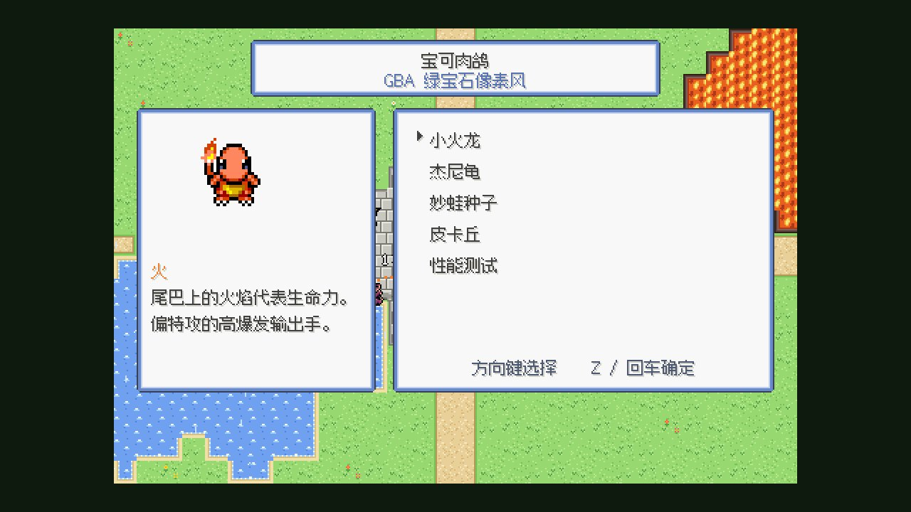
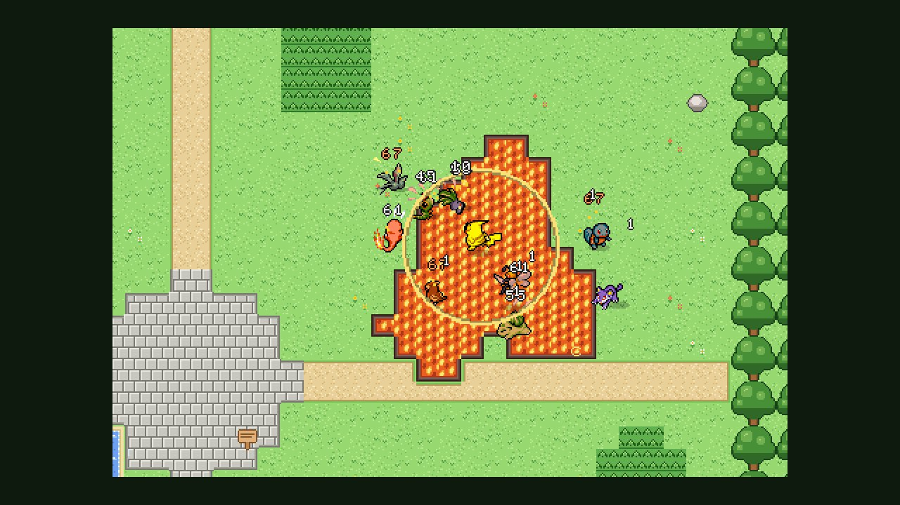
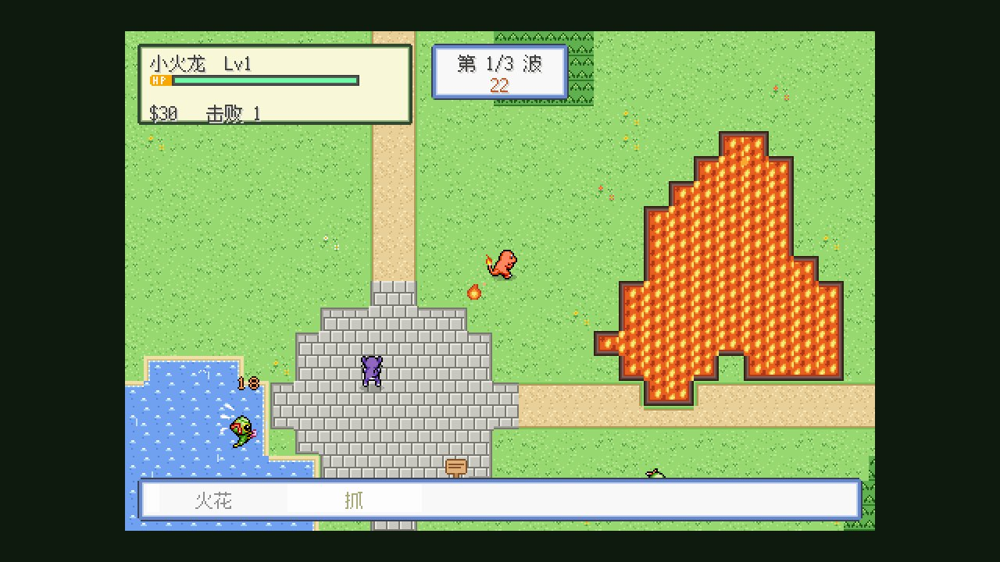

# Poketato · 宝可肉鸽 Unity 版（GBA 绿宝石像素风）

把 Steven 的网页版宝可梦割草肉鸽 [poke-rouge](https://github.com/DietCokewithSugar/poke-rouge)（TypeScript，玩法参考《土豆兄弟》）迁移到 **Unity 6** 的原型。
玩法不变：竞技场里实时移动、技能自动释放、一波波敌人、升级选卡、商店、结算。
画面是纯平面 2D，正交俯视，按《宝可梦 绿宝石》的像素风格画：480×320（正好是 GBA 240×160 的 2 倍）整数倍放大、point 过滤、瓦片地图、窗口式 UI。没有透视相机、3D 光照、阴影、景深或泛光。

- 10 种宝可梦：4 条可选伙伴（小火龙、杰尼龟、妙蛙种子、皮卡丘）+ 6 种第 1~5 波的野生宝可梦（绿毛虫、小拉达、波波、超音蝠、走路草、精英大针蜂）
- 一个完整的小循环：选伙伴 → 3 波生存战（技能自动释放、捡糖果升级）→ 升级选卡 → 商店 → 下一波 → 结算
- 数值直接移植自 poke-rouge 源码（伤害公式、属性克制、刷怪速率、经验曲线、升级卡、道具、局部阵雨/熔岩池场地效果）
- 可部署为 Render 静态站点（仓库内已提交预构建的 WebGL 播放器 `webgl/`）

可行性结论、WebGL 性能数据、扩展到全图鉴的分析和工作量评估见 **[docs/MVP_REPORT.md](docs/MVP_REPORT.md)**；
Render 与 Supabase 的后续计划见 **[docs/DEPLOY_PLAN.md](docs/DEPLOY_PLAN.md)**；素材许可风险见 **[docs/LICENSES.md](docs/LICENSES.md)**。

|  |  |
|---|---|
|  | |

## 搜打撤联机后端

仓库里现在能玩的 WebGL 还是单机原型。搜打撤（进本、实时打、撤离才留战利品）的账号、库存、商城、战队、成就、排行榜和对局结算在：

- `supabase/migrations/`：表、RLS、购买和结算函数
- `server/`：WebSocket 游戏服。普通关 4 人，Boss 和工会副本 8 人，世界战 20 人。伤害和每个技能的输出由服务器写入 Supabase
- `unity/Assets/Scripts/Backend/`：WebGL 可用的 Supabase 客户端
- [`docs/deployment-setup.md`](docs/deployment-setup.md)：要准备哪些密钥、分别放在哪里

## 部署到 Render（静态站点 + 游戏服）

`render.yaml` 有两个服务：静态站点 `poketato-webgl`，以及 Docker WebSocket 游戏服 `poketato-server`。
密钥清单和点击步骤见 [docs/deployment-setup.md](docs/deployment-setup.md)。
当前提交的 `webgl/` 仍是单机原型；联机客户端要等 GitHub Actions 用 Unity 6 LTS 重新构建后才进播放器。

下面是静态站点本身的说明。

Render 不能运行 Unity，所以 WebGL 播放器在本地/CI 构建好后**提交到仓库的 `webgl/` 目录**，Render 只负责原样托管。
构建使用 **gzip + Unity 解压回退（decompression fallback）**：浏览器端的加载器会自己解压 `.unityweb` 文件，
所以**不需要配置任何 `Content-Encoding` 响应头**，任何普通静态主机都能直接打开。`Build/` 里的文件名带内容哈希，可以长期缓存。

**方式 A：Blueprint（推荐）** — 仓库根目录的 [`render.yaml`](render.yaml) 已经写好：

1. Render 控制台 → **New → Blueprint** → 连接 `DietCokewithSugar/Poketato`
2. **Branch** 选要部署的分支（合并后用 `main`）
3. 按提示填写 Supabase 密钥。Render 会建立静态站点 `poketato-webgl` 和游戏服 `poketato-server`

**方式 B：手动创建 Static Site** — 控制台 → **New → Static Site**，填写：

| 设置 | 值 |
|---|---|
| Repository | `DietCokewithSugar/Poketato` |
| Branch | 要部署的分支（合并后用 `main`） |
| Root Directory | 留空（仓库根目录） |
| Build Command | `echo "Using the prebuilt Unity WebGL player committed in webgl/"` |
| Publish Directory | `webgl` |
| Headers（可选） | `/Build/*` → `Cache-Control: public, max-age=31536000, immutable`；`/index.html` → `Cache-Control: no-cache` |

不需要环境变量。更新演示 = 本地重新构建 → 提交 `webgl/` → Render 自动重新部署。

> 想要更小的下载量（Brotli 12.1 MB，gzip 15.6 MB）可以用 `POKETATO_WEBGL_COMPRESSION=brotli` 构建，
> 但那样必须让主机为 `*.br` 返回 `Content-Encoding: br`（见 docs/DEPLOY_PLAN.md），gzip 回退版本没有这个要求。

## 本地运行已构建的版本

```bash
python3 -m http.server 8090 --directory webgl      # 普通静态服务器即可（与 Render 情况相同）
# 打开 http://localhost:8090/
```

`tools/serve_webgl.py --https` 用于测试 Brotli 构建（会为 `.br` 加 `Content-Encoding` 头并生成临时 HTTPS 证书）。

### 操作与 URL 参数

- 标题里用方向键选择，`Z` / 回车确定。战斗中 WASD / 方向键 / 手柄左摇杆移动，技能自动释放
- `Esc` 暂停；`T` 切换 AI 辅助战斗；`F3` 性能面板（FPS、主线程 CPU、Draw Call）

| 参数 | 作用 |
|---|---|
| `?start=pikachu` | 跳过标题直接开局（charmander / squirtle / bulbasaur / pikachu） |
| `?auto=1` | AI 辅助战斗（自动走位） |
| `?photo=0..2&ui=0` | 拍照：10 种宝可梦围在水洼 / 广场 / 熔岩边；`ui=0` 隐藏界面 |
| `?bench=1&secs=8` | 自动性能测试，结果显示在屏幕上并输出到控制台 |
| `?perf=1` | 打开性能面板 |

## 打开 / 重建 Unity 项目

- Unity **6000.3.26f1**（Unity 6.3 LTS），模块：WebGL Build Support。项目在 `unity/`。
- 地图瓦片在运行时由 `ArenaMap` 生成，像素 UI 和图块由 `PixelArt` 绘制，仓库里不存大块贴图。
  管线用 URP 的 2D Renderer，但精灵和瓦片都不走 3D 光照。
- 菜单 **Poketato → Setup Everything** 会从代码重新生成上述全部内容；**Poketato → Build WebGL** 输出到 `webgl/`。

命令行（无界面）重建：

```bash
U=/path/to/Unity-6000.3.26f1/Editor/Unity
$U -batchmode -nographics -projectPath unity -buildTarget WebGL \
   -executeMethod Poketato.EditorTools.PoketatoSetup.All -quit -logFile -
$U -batchmode -nographics -projectPath unity -buildTarget WebGL \
   -executeMethod Poketato.EditorTools.PoketatoBuild.WebGL -logFile -
# 可选：POKETATO_WEBGL_COMPRESSION=brotli|gzip|none  POKETATO_WEBGL_OUT=build/webgl-br
```

首次完整构建约 7 分钟（4 核），之后的增量构建约 2~4 分钟。

### 无头激活 Unity Personal 许可证

在没有图形界面的 CI / 云机器上，用编辑器自带的 Licensing Client 领取 Personal 席位（账号未开 2FA 时可用；凭据从环境变量读，不要写进脚本）：

```bash
"$UNITY_EDITOR_DIR/Data/Resources/Licensing/Client/Unity.Licensing.Client" \
  --activate-all --include-personal --username "$UNITY_EMAIL" --password "$UNITY_PASSWORD"
# 输出 "Status: [200] ASSIGN_SEAT" 即成功；之后 Unity -batchmode 可正常构建
```

`Unity -batchmode -username -password`（不带 `-serial`）只能登录、不能领取 Personal 授权，会报 `No valid Unity Editor license found`。

## 仓库结构

```
unity/                    Unity 6.3 项目（URP 2D Renderer，正交相机）
  Assets/Scripts/Data     从 poke-rouge 移植的数据：属性克制、技能、进化线、敌人、波次、道具、场地
  Assets/Scripts/Sim      单机版游戏模拟（纯 C#，不依赖场景对象，可移到服务器上跑）
  Assets/Scripts/Pixel    像素图集、瓦片地图、精灵、480×320 整数缩放相机、特效
  Assets/Scripts/UI       绿宝石风格窗口、菜单、HUD（运行时生成）
  Assets/Scripts/Perf     帧时间统计、网页桥接（URL 参数、测试结果上报）
  Assets/Editor           PoketatoSetup（一键生成场景）、PoketatoBuild（WebGL 构建）
  Assets/Resources/Pokemon  10 张精灵图集（SpriteCollab，CC BY-NC 4.0，署名见 CREDITS.md）
webgl/                    预构建的 WebGL 播放器（Render 发布目录）
render.yaml               Render Blueprint
tools/                    素材导入、字体子集化、本地服务器、Playwright 冒烟/截图/性能脚本
docs/                     MVP 报告、部署计划、许可说明、截图、性能原始数据
```

## 工具

| 脚本 | 用途 |
|---|---|
| `tools/import_sprites.py <poke-rouge路径>` | 把 10 只宝可梦的 PMD 精灵表打包成每种一张图集，生成帧数据和画师署名 |
| `tools/subset_font.py <zh_hans.ttf>` | 把缝合像素字体裁成代码里用到的 ~570 个字符（7 MB → 90 KB） |
| `tools/serve_webgl.py [--https]` | 本地托管 WebGL（带正确的压缩响应头） |
| `node tools/webgl_perf.mjs --url http://localhost:8090/ --renderer llvmpipe` | 冷启动加载耗时（含 20/5 Mbps 限速）+ 游戏内性能测试，写入 `build/perf/` |
| `node tools/webgl_shots.mjs <url> <输出目录>` | 拍照模式截图 |

Node 脚本依赖 `playwright-core`（`npm i playwright-core`）和本机 Chrome。

## 版权

- 代码：从 poke-rouge（MIT）移植/重写；本仓库还没有 LICENSE 文件，建议沿用 MIT。
- 宝可梦精灵：[PMDCollab/SpriteCollab](https://github.com/PMDCollab/SpriteCollab)，**CC BY-NC 4.0（仅限非商业）**，画师见 `unity/Assets/Resources/Pokemon/CREDITS.md`。
- 字体：[Fusion Pixel Font](https://github.com/TakWolf/fusion-pixel-font)，SIL OFL 1.1（`unity/Assets/Resources/Fonts/OFL.txt`）。
- 地图、窗口和特效是本仓库画的像素图，不是《绿宝石》的原版素材。详见 [docs/LICENSES.md](docs/LICENSES.md)。
- Pokémon 及相关名称、角色是 Nintendo / Creatures Inc. / GAME FREAK / The Pokémon Company 的商标与财产；本项目为非营利粉丝作品。详见 [docs/LICENSES.md](docs/LICENSES.md)。
