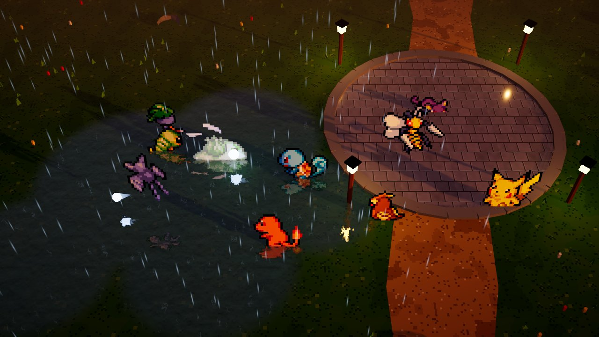
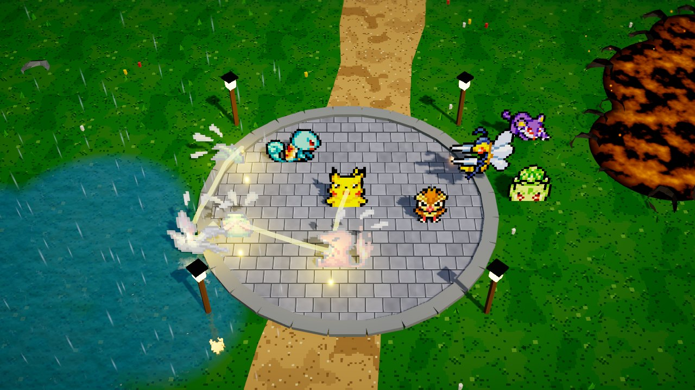
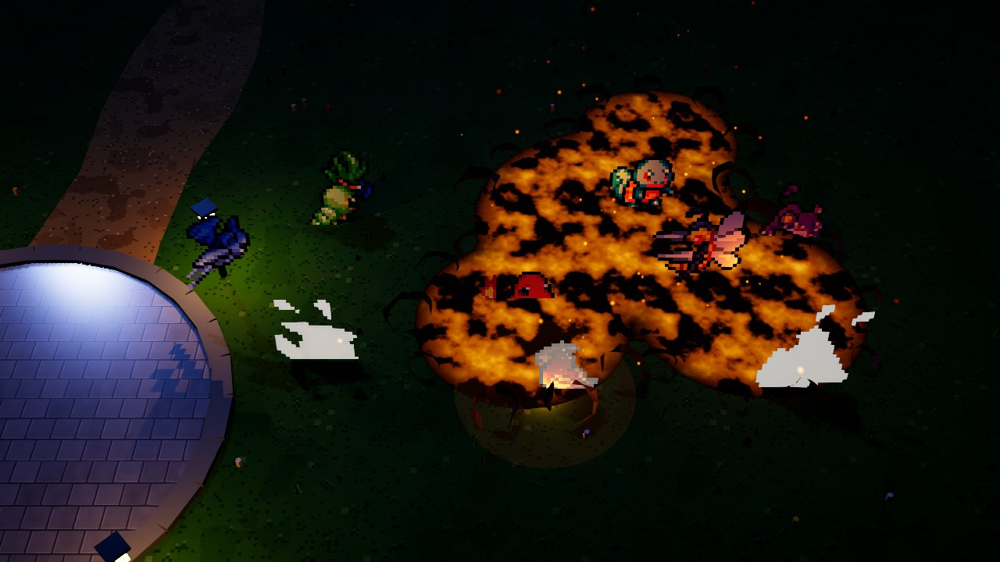
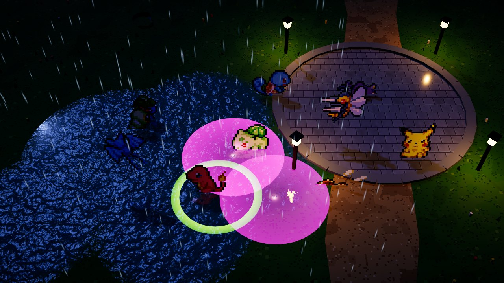

# Unity 迁移可行性 MVP 报告

> 历史文档。这是上一版割草肉鸽原型的记录。当前玩法是宝可梦搜打撤，见 [game-design.md](game-design.md)。

> 画面方向已从 2.5D 改为纯平面 2D 的 GBA 绿宝石像素风（见 README）。下面的帧率、Draw Call 和体积数字是 **2.5D 版本**在软件渲染下测的，不能直接套到现在的 2D 版本；2D 版本去掉了阴影、反射和后处理，GPU 压力会小很多。CPU 和模拟耗时的结论仍然适用。

## 结论：有条件地 GO

Unity 6.3 LTS + URP 能做出想要的 HD-2D 观感，poke-rouge 的核心玩法也能移植，CPU 开销远低于预算。
但下面三件事必须在全面迁移前解决或接受：

1. **真实设备上的 GPU 帧率还没测到**：这台云机器没有 GPU，WebGL 只能用软件渲染跑。下一步请在目标设备上打开 `?bench=1` 跑一次（约 2 分钟，结果显示在屏幕上）。
2. **全图鉴的精灵图集内存**：10 只宝可梦的未压缩图集运行时就占约 44 MB，按现在的做法 151 只会占约 660 MB（再算闪光版约翻倍），必须改成压缩 + 镜像 + 按波次流式加载。
3. **联机架构要重新定**：poke-rouge 是 TypeScript 服务器权威的 4 人联机。迁到 Unity 后，模拟层要么也用 C# 重写服务器（一套代码），要么长期维护 TS 和 C# 两份模拟。这决定了工作量的大头。

建议下一阶段做一个"垂直切片"：完整 20 波 + 联机 2 人 + 在 3~4 台真实设备（含集显笔记本和手机）上跑基准，再决定是否全面迁移。

## MVP 做了什么

| 要求 | 实现 |
|---|---|
| Unity + URP 2.5D | Unity 6000.3.26f1，URP 17.3；像素精灵画在 3D 场景里的直立面片上，略微后仰朝向相机（HD-2D 做法） |
| 动态光照 | 方向光（昼夜三套预设）+ 4 盏灯笼 + 熔岩/晶石点光源 + 技能弹体和爆炸的动态点光源池（低/中/高 2/8/16 个） |
| 实时阴影 | 精灵用 alpha 裁剪投射阴影、也接收阴影；软阴影、级联 1/2/4 级；高画质下一盏灯笼投射点光源阴影 |
| 反射 | 水洼使用**平面反射**（URP 没有 SSR，额外一台镜像相机渲染到 RT，带斜裁剪平面，倒影里有宝可梦）；石板广场用实时反射探针 |
| 后处理 | Bloom、ACES 色调映射、色彩调整、白平衡、暗角；高画质加景深和 SSAO；FXAA / SMAA |
| 10 只宝可梦 | 小火龙、杰尼龟、妙蛙种子、皮卡丘（可选）+ 绿毛虫、小拉达、波波、超音蝠、走路草、大针蜂（精英） |
| 核心循环 | 3 波生存（30/35/40 秒，第 3 波精英大针蜂）→ 每级一张升级卡（含技能领悟）→ 商店（20 种道具 + 招式学习器、刷新）→ 结算 |
| 玩法数值 | 从 poke-rouge 源码移植：伤害公式、本系 1.5 倍、弱化克制表、暴击、经验曲线 (lv+3)²、刷怪速率与上限、敌人 AI（追击/蛇形/射手/大针蜂冲刺）、8 种技能形态（弹体/近身扇形/光束/连锁/落点/持续区域/护盾/强化）、局部阵雨与熔岩池效果 |
| 部署 | 预构建 WebGL 提交在 `webgl/`，gzip + JS 解压回退，Render 静态站点直接托管（`render.yaml`） |

全部内容可从代码重建：`PoketatoSetup.All` 生成 URP 画质资产、材质、程序化贴图和场景；环境网格在加载时按固定种子生成（仓库里没有大体积网格）。

截图（WebGL 构建，Chrome，1280×720，高画质；见 `docs/screenshots/`）：

| | |
|---|---|
|  黄昏水洼：倒影、雨、灯笼、长阴影 |  白天：连锁闪电、实时阴影 |
|  夜晚：熔岩照亮站在上面的宝可梦 |  夜晚水洼与毒粉区域 |

## WebGL 性能

### 测试条件（请先读）

- 机器：4 核 x86 云主机，**没有 GPU**。Chrome 154 通过 ANGLE 使用 Mesa **llvmpipe**（CPU 软件光栅化）渲染 WebGL2。
  所以**墙钟 FPS 是软件渲染的下限，不代表任何真实显卡**。真实设备请跑 `?bench=1`。
- 为了得到和 GPU 无关的数据，基准同时记录**主线程 CPU 时间**（一帧里第一个 Update 到帧结束：脚本 + 渲染提交），
  以及模拟层耗时、Draw Call、三角形数和 wasm 堆大小。
- 被测的是部署版本：gzip + 解压回退，用不带任何压缩头的普通静态服务器托管（与 Render 相同）。
- 场景：`roster10` = 10 种宝可梦全部同屏、全部特效开启；`combat60` / `horde150` = 正常战斗维持 60 / 150 只敌人
  （poke-rouge 单人上限 100、4 人 190）。伙伴使用中期构筑（5 个技能 Lv2、急速 +30%），每项预热 2 秒、采样 8 秒。
- 原始数据：[`docs/perf/webgl-llvmpipe-results.json`](perf/webgl-llvmpipe-results.json)；复现：`node tools/webgl_perf.mjs --url http://localhost:8090/ --renderer llvmpipe`。

### 帧时间（1280×720）

| 画质 | 场景 | 平均 FPS（软件渲染） | 平均 / p95 / p99 帧时间 ms | 主线程 CPU 平均（p95）ms | 模拟 ms | 精灵 | Draw Call | 三角形 |
|---|---|---|---|---|---|---|---|---|
| 低 | 10 种同屏 | 19.7 | 50.9 / 57 / 62 | 3.8 (5.3) | 0.12 | 10 | 83 | 69k |
| 低 | 60 只敌人 | 20.3 | 49.3 / 54 / 58 | 2.9 (4.0) | 0.18 | 60 | 179 | 86k |
| 低 | 150 只敌人 | 18.1 | 55.3 / 63 / 70 | 4.3 (5.9) | 0.31 | 150 | 318 | 102k |
| 中 | 10 种同屏 | 12.0 | 83.1 / 92 / 226 | 5.4 (3.9) | 0.09 | 10 | 123 | 125k |
| 中 | 60 只敌人 | 11.6 | 86.2 / 99 / 102 | 4.0 (4.9) | 0.15 | 61 | 281 | 148k |
| 中 | 150 只敌人 | 10.3 | 97.4 / 109 / 114 | 5.2 (6.7) | 0.27 | 151 | 521 | 169k |
| 高 | 10 种同屏 | 5.1 | 197 / 207 / 502 | 17.0 (7.4) | 0.11 | 10 | 284 | 390k |
| 高 | 60 只敌人 | 4.9 | 203 / 211 / 215 | 5.5 (6.9) | 0.14 | 61 | 379 | 402k |
| 高 | 150 只敌人 | 4.6 | 219 / 233 / 234 | 7.1 (8.7) | 0.32 | 150 | 557 | 419k |

wasm 堆在所有场景下稳定在 **115 MB**。

解读：

- **CPU 不是瓶颈**：150 只敌人时主线程每帧 4~7 ms（p95 ≤ 8.7 ms），模拟层 ≤ 0.32 ms。16.7 ms（60 FPS）的预算里 CPU 侧余量很大。
  （高画质"10 种同屏"平均 17 ms 是切换到高画质后头几帧的着色器编译拖高的，见下面的卡顿。）
- **画面成本主要在 GPU 侧**：中→高三角形翻 3 倍（4 级阴影级联 + SSAO 深度法线 + 点光源阴影 6 个面），软件渲染下帧时间也翻了一倍多。
  这些都是成熟显卡很便宜、集显和手机很贵的功能，所以三档画质的设计是对的，"中"应作为网页默认。
- **卡顿**：低/中画质的帧时间分布很紧（p95 只比平均高 10% 左右），没有看到 GC 尖峰。可见的尖峰（131 / 226 / 502 ms）都出现在每档画质的第一个场景开头，
  来自切换 URP 资产和首次使用时的着色器编译。正式版需要用 ShaderVariantCollection 在加载时预热。
- **Draw Call 随精灵数线性增长**（中画质 10 → 150 只：123 → 521）。每个精灵在主相机、阴影级联、反射相机里各画一次，
  GPU Instancing 在当前设置下没有合批（可能是 URP 前向渲染的逐物体光源列表打断了合批）。CPU 现在扛得住，
  但要支撑 4 人联机 190 只敌人 + 弹幕，需要改成按物种合批（`Graphics.RenderMeshInstanced` 或 Forward+）。

### 构建体积与加载

| 文件（部署版：gzip + 解压回退） | 大小 |
|---|---|
| `*.wasm.unityweb`（引擎 + IL2CPP 代码） | 10.11 MB |
| `*.data.unityweb`（资源） | 5.41 MB |
| `*.framework.js.unityweb` | 0.09 MB |
| `*.loader.js`（含 JS 解压器） | 0.05 MB |
| **合计** | **15.65 MB** |

同一项目用 Brotli（需要服务器返回 `Content-Encoding: br`）是 **12.1 MB**（wasm 7.24 + data 4.76）。
资源的未压缩体积 52 MB，其中 96% 是贴图：10 张精灵图集 44 MB（大针蜂一张 7.9 MB）+ Unity 启动画面 2.7 MB。

冷启动（全新浏览器上下文，无缓存，中画质）：

| 网络 | 实例就绪 | 第一帧游戏画面 |
|---|---|---|
| 本机（无延迟） | 1.0 s | 3.2 s |
| 20 Mbps / 40 ms RTT | 7.4 s | 9.5 s |
| 5 Mbps / 80 ms RTT | 26.3 s | 28.5 s |

"实例就绪"到"第一帧"之间的约 2 秒是 **Unity Personal 强制显示的 Made with Unity 启动画面**（Personal 版无法关闭）。
第二次打开时资源从浏览器缓存（IndexedDB）读取，基本只剩启动画面和初始化的时间。

## 扩展到全图鉴需要什么

| 问题 | 现状 | 151 只（+闪光）时 | 做法 |
|---|---|---|---|
| 精灵图集内存 | 10 只未压缩 44 MB | 约 660 MB（闪光再翻倍），网页上不可行 | ① GPU 压缩（BC7/ASTC 4×4，32→8 bpp，-75%）② 左侧 3 个方向用右侧镜像（8→5 行，-37%）③ 裁掉帧里的透明边 ④ Addressables 按波次加载：同屏通常只有本波 5~15 种 + 队伍。估算全部 151 只约 60 MB 磁盘、常驻 5~10 MB |
| 下载体积 | 精灵占 data 的大头（Brotli 后约 0.45 MB/种） | 全部打进首包约 70 MB | 首包只放城镇和初始伙伴，其余物种做成远程资源包按需下载并缓存 |
| Draw Call | 每个精灵每个 pass 一次 | 190 只敌人 + 弹幕时 CPU 会吃紧 | 按物种合批（实例化或动态合并网格），与精灵数无关 |
| 模拟 CPU | 150 只 0.3 ms | 4 人 190 只 + 85 种特性 + 150 个技能：仍在 1~2 ms 量级 | 主要是移植工作量，不是性能风险 |
| 着色器 | 首次使用时编译，造成数百毫秒卡顿 | 场地、技能特效变多后更明显 | 变体收集 + 加载时预热；控制关键字数量 |
| wasm 体积 | Brotli 7.2 MB | 代码增长有限 | IL2CPP OptimizeSize、更高剥离等级、去掉不用的 URP 功能，通常能减 15~30% |
| 移动端 | 未测 | iOS Safari 内存上限低、WebGL 填充率弱 | 移动端默认低画质、关平面反射；或考虑原生 App |

## Unity 许可证与工具

- **无头激活成功**：`Unity -batchmode -username -password` 只能登录（账号没有 2FA 拦截），但不会领取 Personal 授权。
  编辑器自带的 `Unity.Licensing.Client --activate-all --include-personal --username … --password …` 可以无头领取 Personal 席位
  （返回 `ASSIGN_SEAT`），之后 batchmode 构建正常。命令写在 README。CI 里可以直接复用（凭据放在 secrets 里）。
- Unity Personal：年收入/融资 20 万美元以下免费；**WebGL 启动画面无法关闭**（加载多约 2 秒）。
- **Unity MCP**：这个云端环境里没有可用的 Unity MCP 服务器（会话中也无法新注册 MCP），所以改用 batchmode 下的 C# 编辑器脚本完成全部自动化
  （项目设置、资源生成、场景搭建、构建），效果等同且可复现。日常在 Cursor 桌面端开发时可以接 Unity 官方的 AI Assistant MCP 或社区的 unity-mcp。

## 风险

| 风险 | 影响 | 应对 |
|---|---|---|
| 真实设备 GPU 表现未验证 | 集显/手机可能只能跑低画质 | 下一步在目标设备跑 `?bench=1`；默认中画质，自动降档 |
| 联机重写 | poke-rouge 的服务器权威模拟、快照压缩、流量控制都要重做或跨语言维护 | 尽早决定：C# 服务器（共享 Sim 代码，Render 用 Docker 跑 .NET）或保留 TS 服务器 + 协议适配 |
| 精灵内存与下载 | 全图鉴不处理会爆内存 | 见上表；先做资源管线再扩图鉴 |
| 着色器编译卡顿 | 首次释放技能、切换场地时卡几百毫秒 | 变体预热 |
| 素材许可 | 精灵 CC BY-NC、PokéRogue 素材 NC-SA/合理使用、任天堂 IP | 保持非营利；不要复制 PokéRogue 的 AGPL 代码；详见 LICENSES.md |
| Unity 平台依赖 | 版本升级、许可政策变化、WebGL 首包体积 | 锁定 LTS；构建体积纳入 CI 检查 |
| 中国大陆访问 | Render 线路跨境慢，15 MB 首包更明显 | 静态资源上 CDN（国内节点）；Brotli；资源包按需下载 |

## 全面迁移工作量（按子系统，不估日历时间）

poke-rouge 现有约 2.5 万行 TypeScript（不含测试），迁移基本等于用 C# 重写客户端和模拟层，规模与原项目相当。

| 子系统 | poke-rouge 规模 | MVP 已覆盖 | 难度 | 说明 |
|---|---|---|---|---|
| 模拟核心（波次、刷怪、AI、伤害、玩家、商店） | `src/shared/sim` 约 4.3k 行 | 约 25%（3 波、4 种 AI、25 个技能、20 个道具、2 种场地） | 中 | 结构已经搭好，逐个补技能形态、异常状态、精英/首领 AI |
| 数据表（151 图鉴、150+ 技能、126 道具、85 特性、道馆、训练家、成就） | 约 5.5k 行 | 约 10% | 中（机械） | 建议写 TS→C# 的数据导出脚本，避免手抄 |
| PvP 模拟与匹配 | 约 1.2k 行 | 0 | 中 | 依赖联机方案 |
| 联机（房间、快照、插值、断线重连、AI 接管） | 服务器 1.4k + 协议/同步约 0.6k + 客户端网络 | 0 | **高** | 最大的架构决策；WebGL 只能用 WebSocket |
| 渲染与特效（精灵、技能特效、8 种场地、城镇） | 约 5.8k 行 | 约 30% | 中~高 | 2.5D 美术方向的工作量：3D 真新镇、8 种场地的 3D 表现、150 个技能的特效 |
| UI（城镇、商店、结算、道馆、对战、账号、引导、图鉴） | 约 4.5k 行 | 约 15% | 高 | 页面多，适合改用 UI Toolkit 并做组件库 |
| 存档 / 账号 / Supabase | 服务器代理 | 0 | 低~中 | 沿用现有表结构和服务器代理（见 DEPLOY_PLAN.md） |
| 资源管线（151 只 + 闪光、压缩、流式） | — | 10 只的导入脚本 | 中 | 见"扩展到全图鉴" |
| 测试与平衡工具 | 约 5k 行 | 0 | 中 | Sim 是纯 C#，可以用同样的机器人跑无头平衡测试 |
